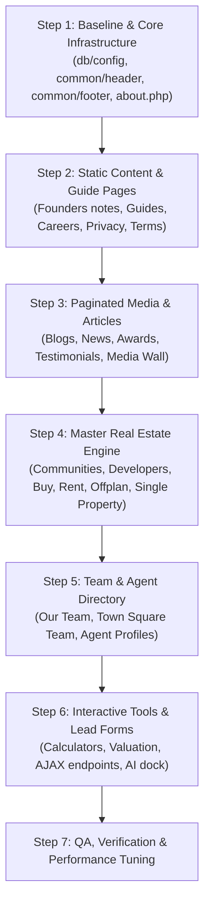

# DRE Homes: Dynamic Architecture & Migration Master Plan (`rule.md`)

> **Every page must follow [Section 9: Page Coding Standards](#9-page-coding-standards-mandatory-for-every-page).**
> Read it before converting or editing any page. A page is not finished until it passes the checklist in 9.11.

## 1. Project Overview & Comparison

This document establishes the architecture, standards, and step-by-step roadmap for converting the new frontend UI (`dre-homes-new-ui`) into a fully dynamic web application powered by the backend methods, database structure, and AJAX engines from the older project (`dre-homes-v2`).

| Parameter | Older Project (`dre-homes-v2`) | New UI Project (`dre-homes-new-ui`) | Target Hybrid State |
| :--- | :--- | :--- | :--- |
| **Local URL** | `http://localhost/dre-homes-v2/` | `http://localhost/dre-homes-new-ui/` | `http://localhost/dre-homes-new-ui/` |
| **Reference Page** | `about-us.php` (`/about-us`) | `about.php` (`/about-us`) | Fully dynamic `about.php` |
| **Frontend Stack** | Bootstrap 4/Custom CSS, jQuery, Font Awesome | Bootstrap 5.3 (Cascade Layer), Custom Glassmorphism Theme, Vanilla JS / jQuery, intl-tel-input | New UI styles & JS preserved 100% |
| **Data Engine** | MySQL (`dhrealestate_dre_ws`), Procedural PHP helpers | Initially static HTML (`*.html`) with client-side JS filtering | Procedural PHP helpers (`select_row`, `select_all`, etc.) feeding new UI components |
| **Asset Engine** | `admin_nsrdwsc/assets/media/` for uploads | Standalone assets + admin media folder | `BASE_URL_IMG` pointing to media directory; `asset_url()` for theme assets |
| **Pagination** | Server-side AJAX via `ajax/*_paging.php` + `pagination/` | Hardcoded HTML with client-side hide/show in `site.js` | Server-side AJAX delivering **New UI Card Markup** |
| **Lead Forms** | jQuery AJAX -> `ajax/*_frm.php` -> DB & Email | Static JS fake alert/message | AJAX form submissions with real validation, DB insertion & email alerts |

---

## 2. Directory & Architecture Structure

```text
dre-homes-new-ui/
├── .env / .env.example       # Environment configuration (DB, SMTP, AI API keys)
├── .htaccess                 # Clean URLs, rewriting, cache control, security rules
├── config/
│   ├── load.php              # Loads .env and secrets via secret() helper
│   ├── secrets.php           # Development secrets fallback
│   └── secrets.example.php   # Secret template
├── db/
│   ├── config.php            # Session, timezone, mysqli connection, BASE_URL, BASE_URL_IMG
│   ├── functions.php         # DB queries, helpers, escaping, and UI URL builders
│   └── migrations/           # Database migration scripts
├── common/
│   ├── header.php            # Dynamic <head>, meta tags, navbar, currency switcher, mobile menu
│   └── footer.php            # Dynamic footer, contact info, top communities/devs, AI dock, scripts
├── ajax/
│   ├── *_paging.php          # Server-side pagination & filter endpoints (return New UI HTML/JSON)
│   ├── *_frm.php             # Form submission handlers (Offplan, Valuation, Visa, Mortgage, etc.)
│   └── get-suggestions.php   # Live search autocomplete endpoints
├── pagination/
│   └── paging_*.php          # Pagination button rendering templates
├── assets/
│   ├── css/                  # main.css (glassmorphism theme), suggest.css, page-specific css
│   ├── js/                   # main.js (core UI/dock/modal), site.js (page interactive features)
│   └── img/                  # Theme logos and static icons
├── admin_nsrdwsc/
│   └── assets/media/         # Admin uploaded media (projects, teams, blogs, developers, communities)
├── index.php                 # Dynamic Home page
├── about.php                 # Dynamic About Us page (Reference Implementation)
└── [page].php                # Other dynamic pages ported from [page].html / v2 [page].php
```

---

## 3. Core Configuration & Database Guidelines

### 3.1 Base Constants (`db/config.php`)
Every dynamic page must include `db/config.php` at line 1:
```php
<?php
ob_start();
session_start();
date_default_timezone_set('Asia/Kolkata');

require_once __DIR__ . '/../config/load.php';

define('BASE_URL', 'http://localhost/dre-homes-new-ui/');
define('BASE_URL_IMG', BASE_URL . 'admin_nsrdwsc/assets/media/');

$conn = mysqli_connect('localhost', 'root', '', 'dhrealestate_dre_ws');
if (!$conn) {
    die('Database Connection Failed: ' . mysqli_connect_error());
}

mysqli_set_charset($conn, 'utf8mb4');
$date = date('Y-m-d H:i:s');
include_once('functions.php');
?>
```

### 3.2 Standard Helper Functions (`db/functions.php`)
Always use the centralized helpers rather than writing raw queries across template files:
1. **`select_row($table, $condition)`**:
   Returns an associative array for a single row (or false).
   *Example:* `$about = select_row('tbl_abt_content', 'is_active=1');`
2. **`select_all($table, $condition)`**:
   Returns an array of rows.
   *Example:* `$counters = select_all('tbl_abt_counter', 'is_active=1 ORDER BY abt_countr_id DESC');`
3. **`select_query($table, $condition)`**:
   Returns a `mysqli_result` object for while loop iterations.
4. **`e($string)`**:
   Sanitizes and HTML-escapes output after decoding entities. Prevents XSS and avoids double-encoding.
5. **`page_link($page, $fallback)`**:
   Returns clean root-relative or absolute URL (`BASE_URL . $page`), checking for existence.
6. **`asset_url($path)`**:
   Resolves static assets correctly regardless of URL depth.

---

## 4. Common Components (`common/` Folder)

### 4.1 Header (`common/header.php`)
Every page must follow the standard inclusion pattern (full skeleton in [9.1](#91-page-file-layout)): config, SEO tags, **all data**, then the header.
```php
<?php
include('db/config.php');

// SEO: Admin > Manage Tags ("About Us")
$meta_tags = select_row('tbl_tags', 'id=14 and is_active=1');

// Admin > About > About Content
$about = select_row('tbl_abt_content', 'is_active=1') ?: [];

include('common/header.php');
?>
```
**Automatic in `common/header.php`:** `assets/css/pages/<page-file-name>.css` is loaded when it exists, and the active menu item is worked out from the file name. Extra CSS/JS or a different active item can be passed with `$page = ['active' => 'about', 'css' => [...], 'js' => [...]];` before the include.
**Dynamic features in `common/header.php`:**
- Dynamically loads `meta_title`, `meta_description`, `meta_keyword`, `meta_og_img`, and `favicon_logo`.
- Fetches logos and certifications from `tbl_header_info` (e.g. Great Place To Work badge).
- Builds the Services menu dynamically by querying `tbl_service_section`.
- Generates clean links for both desktop nav and mobile offcanvas navigation.
- Embeds pre-paint night mode script to eliminate theme flickering.

### 4.2 Footer (`common/footer.php`)
**Dynamic features in `common/footer.php`:**
- Loads address, toll-free number, hotline, email, permit number, and copyright from `tbl_footer_info`.
- Top 5 Communities by project count (`COUNT(*) AS total_proj FROM tbl_proj ...`).
- Top 5 Developers by project count.
- Social media links dynamically mapped to modern SVG icons.
- Floating quick-contact dock: WhatsApp link, AI Assistant trigger, Live Agent call button, and Night Mode toggle.
- AI Assistant chat modal dialog.
- Core script stack: Bootstrap 5.3 bundle, `main.js`, and `site.js`.

---

## 5. Reference Implementation: About Us (`about.php`)

The About Us page (`http://localhost/dre-homes-new-ui/about.php` / `/about-us`) is the foundational model for migrating pages.

### 5.1 Database Mapping Table
| Section in New UI | Table & Query | Fields Used | UI Adaptation Rule |
| :--- | :--- | :--- | :--- |
| **SEO Meta** | `tbl_tags` (`id=14`) | `meta_title`, `meta_description`, `meta_keyword`, `meta_og_img` | Passed to `common/header.php` via `$meta_tags`. |
| **Hero Banner** | `tbl_abt_content` (`is_active=1`) | `abt_content_bannr_img`, `abt_content_title`, `abt_content_heading` | Last word highlighted with `<em class="gold-text">`. Image loaded from `BASE_URL_IMG . 'about/'`. |
| **Hero Intro & Ethos** | `tbl_abt_content` (`abt_content_descp`) | Rich text HTML paragraphs | Paragraph 1 extracted for hero `.sub`. Last paragraph extracted for the floating `.ethos` glass block. Middle paragraphs rendered as story `.lead`. |
| **Story Button & Video** | `tbl_abt_content` | `abt_content_btn_text`, `abt_content_btn_url`, `abt_content_img`, `abt_content_video`, `abt_content_vdo_text` | Renders video play button opening HTML5 dialog `#videoModal`. |
| **Milestone Stats** | `tbl_abt_counter` (`is_active=1 ORDER BY abt_countr_id DESC`) | `abt_countr_counter`, `abt_countr_heading`, `abt_countr_faicon` | Outputs `<strong class="gold-text" data-n="X">0</strong>` animated on scroll by `main.js`. |
| **What Sets DRE Apart** | `tbl_abt_service` (`is_active=1 ORDER BY abt_serv_id DESC`) | `abt_serv_heading`, `abt_serv_descp`, `abt_serv_faicon` | "Mission" and "Vision" become large cards (`.val.big.acc-edge`). Other items become standard cards. Font Awesome icons converted to sleek SVG icons. |
| **Leadership** | `tbl_team` (`team_company_owner=1 AND is_active=1`) | `team_name`, `team_desg`, `team_img`, `team_slug`, `team_fblink`, `team_linkedinlink`, `team_instagramlink`, `team_twitterlink` | Cards link to `BASE_URL . 'management/' . $slug`. Social links render SVG icons. |
| **Consultation CTA Form** | `tbl_offplan_enq` / `tbl_bookval_frm` | Full Name, Phone with country code, Message | Wire `#ctaForm` via AJAX to `ajax/offplan_frm.php` (or dedicated lead endpoint) instead of dummy JS. |

---

## 6. AJAX, Pagination & Form Handling Standards

### 6.1 Form Submission Workflow (`ajax/*_frm.php`)
Every form in the new UI must connect to an active backend endpoint:
1. **Frontend (`assets/js/main.js` / `site.js`)**:
   - Collects fields via `FormData` or `.serialize()`.
   - Formats international phone using `intlTelInput.getNumber()`.
   - Sends AJAX POST to `BASE_URL + 'ajax/<form_name>_frm.php'`.
   - Displays real loading states and feedback messages (`r.status === 'success'`).
2. **Backend Handler (`ajax/<form_name>_frm.php`)** (rules in [9.8](#98-forms-and-ajax-endpoints); reference: `ajax/career_frm.php`):
   - Validates every input on the server and saves with prepared statements (`db_query($sql, [$params])`), never by putting `$_POST` values into the SQL string.
   - Obtains client IP via `get_client_ip()` and country via `ip_details()`.
   - Inserts into target database table (`tbl_offplan_enq`, `tbl_bookval_frm`, `tbl_goldvisa_enq`, `tbl_mortg_frm`).
   - Sends notification emails to `leads@drehomes.ae`.
   - Returns JSON: `{"status": "success", "msg": "Thank you, we will contact you shortly!"}`.

### 6.2 AJAX Pagination Workflow (`ajax/*_paging.php` & `pagination/`)
When migrating paginated listing pages (e.g., `blogs.php`, `buy-property.php`, `offplan-properties.php`):
1. **Critical Rule**: Do NOT output the old project's HTML tags (`.post-item`, `.geodir-category-listing`) from AJAX endpoints.
2. Update the AJAX endpoints to output the **New UI card markup** (`<article class="bc glass">`, `<article class="oc glass">`).
3. The pagination markup in `pagination/paging_*.php` must output the new UI's pagination styling (`.page-numbers`, `.current`, `.prevposts-link`, `.nextposts-link`).
4. Keep filter attributes (`data-c`, `data-y`, `data-p`, `data-bmin`, `data-bmax`) intact so new UI interactions continue working.

---

## 7. URL Routing & SEO Standards (`.htaccess`)

Ensure consistent URL routing between the old and new project:
- Extensionless clean routes:
  - `/about-us` -> `about.php`
  - `/blogs` -> `blogs.php`
  - `/buy-property` -> `buy-property.php`
  - `/rent-property` -> `rent-property.php`
  - `/offplan-properties` -> `off-plans.php` or `offplan-properties.php`
  - `/communities` -> `communities.php`
  - `/developers` -> `developers.php`
  - `/our-team` -> `our-team.php`
- Dynamic detail pages:
  - `RewriteRule ^community/([^/]+)/?$ community-single.php?slug=$1 [L,QSA]`
  - `RewriteRule ^developer/([^/]+)/?$ developers-single.php?slug=$1 [L,QSA]`
  - `RewriteRule ^management/([^/]+)/?$ agent-single.php?slug=$1 [L,QSA]`
  - `RewriteRule ^our-blogs/([^/]+)/?$ blog-single.php?slug=$1 [L,QSA]`
  - `RewriteRule ^property/([^/]+)/?$ single-property.php?slug=$1 [L,QSA]`
  - `RewriteRule ^company-news/([^/]+)/?$ company-news-single.php?slug=$1 [L,QSA]`

---

## 8. Step-by-Step Migration Roadmap



### Detailed Execution Phases:

#### Phase 1: Core Foundation & About Us Baseline (Completed)
- [x] Configure `db/config.php` and test database connection to `dhrealestate_dre_ws`.
- [x] Ensure `BASE_URL` and `BASE_URL_IMG` work seamlessly and media files resolve.
- [x] Establish `common/header.php` and `common/footer.php` with 100% exact SEO meta tags, OpenGraph cascade, Canonical URL, Schema JSON-LD structured data, and Google Tag Manager (GTM-NDFF757K).
- [x] Implement and verify `about.php` against `tbl_abt_content`, `tbl_abt_counter`, `tbl_abt_service`, and `tbl_team`.
- [x] Connect `#ctaForm` on `about.php` to dynamic AJAX lead submission endpoint (`ajax/offplan_frm.php` inserting into `tbl_offplan_enq`).


#### Phase 2: Content, Guide & Brand Pages
- [x] Migrate `founders-note-ceo.html` & `founders-note-clo.html` using `tbl_msg_from_ceo` / `tbl_msg_from_foundr` (shared partial `common/founders-note.php`, SEO tags id 26 / 25, v2 URLs `/message-from-co-founder-and-ceo` / `-clo`).
- [ ] Migrate `buyer-guide.html`, `seller-guide.html`, `tenant-guide.html`, `landlord-guide.html` using `tbl_guide`.
- [ ] Migrate `privacy-policy.html` and `terms-conditions.html` using `tbl_privacy_policy` and `tbl_tags`.
- [x] Migrate `careers.html` using `tbl_career_content`, `tbl_position`, `tbl_focus_area`, `tbl_career_awards`, `tbl_career_gallery` (SEO tags id 18) and the resume handler `ajax/career_frm.php` (saves to `tbl_resume` + `resume/`).
- [x] Migrate `bank-account-opening.html` to `bank-account-opening.php` dynamically connected to Admin > Services > Edit Service Section (`tbl_service_section`, id = 7 / `edit-service-section.php?edit=Nw==`). Hero banner image saved and updated in admin (`meta_og_img_bank_account_opening_hero.jpg`). Interactive document checklists for UAE citizens, residents, and non-residents, joint accounts guidance, IBAN section, dynamic other services grid, and `#ctaForm` AJAX consultation lead form. Original `bank-account-opening.html` archived to `old-html/bank-account-opening.html`.
- [x] Migrate `business-licenses.html` to `business-licenses.php` dynamically connected to Admin > Services > Edit Service Section (`tbl_service_section`, id = 8 / `edit-service-section.php?edit=OA==`). Connected hero banner image from admin `meta_og_img`, dynamic SEO tags, stats, interactive document checklists (`nl`, `il`, `el`), 8 setup steps, legal forms, fees & timing breakdown, other services grid, and `#ctaForm` lead consultation form. Original `business-licenses.html` archived to `old-html/business-licenses.html`.
- [x] Migrate `relocation-service.html` to `relocation-service.php` dynamically connected to Admin > Services > Edit Service Section (`tbl_service_section`, id = 6 / `edit-service-section.php?edit=Ng==`). Connected hero banner image from admin `meta_og_img`, dynamic SEO tags, stats, who we help cards (individual / corporate), 5-step journey with clean page links, why DRE section, other services grid, and `#ctaForm` relocation consultation form. Original `relocation-service.html` archived to `old-html/relocation-service.html`.
- [x] Migrate `property-investment-consultancy.html` to `property-investment-consultancy.php` dynamically connected to Admin > Services > Edit Service Section (`tbl_service_section`, id = 3 / `edit-service-section.php?edit=Mw==`). Connected hero banner image from admin `meta_og_img` (`meta_og_img_property_investment_consultancy.jpg`), dynamic SEO tags, stats, who we help cards, 4-step acquisition journey (sourcing to asset management), why DRE section, dynamic other services grid, and `#ctaForm` lead consultation form. Original `property-investment-consultancy.html` archived to `old-html/property-investment-consultancy.html`.
- [x] Convert `brand-video.html` to `brand-video.php` dynamically connected to Admin > Brand video page (`tbl_brand_video_content`, id = 1 / `edit-brand-video-content.php?edit=MQ==`) and Admin > Manage Tags (`tbl_tags`, id = 35). Connected hero banner image (`brand_video_cont_img`), dynamic heading with gold accent, story paragraphs, video player (YouTube and local video support), pillars, family card, and consultation CTA lead form. Original `brand-video.html` archived to `old-html/brand-video.html`.

#### Phase 3: Paginated Editorial & Media Pages
- Convert `blogs.html` to `blogs.php` and update `ajax/blog_paging.php` to output the new UI's `<article class="bc glass">` structure.
- Convert `company-news.html` to `company-news.php` and update `ajax/company_news_paging.php`.
- [x] Convert `our-awards.html` to `our-awards.php` using `tbl_awards_content` + `tbl_awards` (SEO tags id 17). The whole list is printed once and filtered in the browser, so `ajax/awards_paging.php` is not needed. Award year and partner are read from the award text (see the comment in `our-awards.php`); `award_year` / `award_partner` columns are used automatically if added to the admin.
- [x] Convert `clients-testimonials.html` to `clients-testimonials.php` using `tbl_testimonial_content` + `tbl_testimonial` (SEO tags id 16). All reviews are printed once; the page's JS filters and shows 18 at a time, so `ajax/clients_testimonial_paging.php` is not needed. Topics (buying / renting / selling) and the advisors a review mentions (team members named in the text) are worked out in the page's prepare block.
- [x] Convert `our-media.html` to `our-media.php` using `tbl_media_content` + `tbl_media` (Admin > Media, SEO tags id 24). Captions are cleaned alt texts; categories come from words in the caption; highlight stories are runs of 7+ photos in a row with the same caption. All photos are printed once; the page's JS filters and shows 24 at a time.
- Implement single pages: `blog-single.php` and `company-news-single.php`.

#### Phase 4: Core Real Estate Engine (Properties, Communities, Developers)
- Convert `communities.html` to `communities.php` and create `community-single.php` using `tbl_community` and `tbl_community_content`.
- Convert `developers.html` to `developers.php` and create `developers-single.php` using `tbl_developer` and `tbl_developer_content`.
- [x] Convert `offplan-properties.html` to `offplan-properties.php` dynamically connected to Admin > Manage Tags (id 8 / `edit-tags.php?edit=OA==`) for hero banner image (`meta_og_img`), title, keywords, and description (`meta_description`), and Admin > Manage Projects (`manage-project.php` / `tbl_proj` type 1, `is_active = 1`) + developer + community + `tbl_ai_proj_facts` (price_aed coalesce). All active projects are printed with data attributes; the page's JS (`site.js`) filters, sorts, searches, and pages 9 at a time. Broken thumbnail fallback and `#ctaForm` AJAX lead handler included.
- [x] Convert `buy-property.html` to `buy-property.php` dynamically connected to Admin > Manage Tags (id 19 / `edit-tags.php?edit=MTk=`) and Admin > Manage Buy Projects (`manage-buy-project.php` / `tbl_proj` type 7, `is_active = 1`) + `tbl_community` + `tbl_ai_proj_facts`. Hero banner image saved to admin (`meta_og_img_buy_property_hero.jpg`). All 78 active properties printed with exact data attributes for `site.js`; exclusive carousel (`#exTrack`) rendered from featured properties (`proj_markfeat = 1`); filter bar with dynamic communities, types, price tiers, and bed/bath/size chips; `#ctaForm` AJAX consultation lead form connected. Original `buy-property.html` archived to `old-html/buy-property.html`.
- [x] Convert `rent-property.html` to `rent-property.php` dynamically connected to Admin > Manage Tags (id 20 / `edit-tags.php?edit=MjA=`) and Admin > Manage Rent Projects (`manage-rent-project.php` / `tbl_proj` type 8, `is_active = 1`) + `tbl_community` + `tbl_ai_proj_facts`. Hero banner image saved to admin (`meta_og_img_rent_property_hero.jpg`). All 43 active rental properties printed with exact data attributes for `site.js`; exclusive carousel (`#exTrack`) rendered from featured properties (`proj_markfeat = 1`); filter bar with dynamic communities, types, price tiers, and bed/bath/size chips; `#ctaForm` AJAX consultation lead form connected. Original `rent-property.html` archived to `old-html/rent-property.html`.
- [x] Convert `ready-to-move-in.html` to `ready-to-move-in.php` dynamically connected to Admin > Ready To Move In (tbl_readytomovein_content, id 1 / `edit-readytomovein-content.php?edit=MQ==`), Admin > Manage Tags (id 9 / `edit-tags.php?edit=OQ==`), and Admin > Manage Projects (`manage-project.php` / `tbl_proj` type 2, `is_active = 1`) + developer + community + `tbl_ai_proj_facts`. Quick developer filter buttons (`#quickDev`), segmented property type switch (`#emSeg`), filter bar (`#devSel`, `#locSel`, `#pMin`, `#pMax`), bedroom chips, live grid (`#opGrid` with `data-fav-key="dre-favs-ready"`), and consultation CTA lead form (`#ctaForm`). Original `ready-to-move-in.html` archived to `old-html/ready-to-move-in.html`.
- [x] Ready to move in detail page `ready-to-move-in-single.php` (`/ready-to-move-in/<slug>`, design `ready-paradise-view-2-majan.html`): `tbl_proj` (`prj_type_id = 2`, `is_active = 1`) + `tbl_developer` + `tbl_proj_gallery` + `tbl_proj_featfac`. Lightbox gallery (`#pdPhotos`), quick facts, overview text, SVG amenities, location map (`#mapLoad`), downloads modal (`#dl`), consultation CTA form (`#ctaForm`) wired to AJAX, and similar ready homes carousel (`#simTrack`). Includes 5-way cross-route fallback redirect between off-plan, buy, rent, international, and ready-to-move-in. Original `ready-paradise-view-2-majan.html` archived to `old-html/ready-paradise-view-2-majan.html`.
- [x] Off-plan detail page `single-property.php` (`/property/<slug>`, design `property-palace-residences-hillside.html`): `tbl_proj` + developer + community, `tbl_proj_gallery`, `tbl_proj_payplan`, `tbl_proj_featfac`; SEO from the project's own meta fields. Slug looked up with a prepared statement; unknown slugs go back to `/offplan-properties`. Images whose file is missing are skipped.
- [x] Buy / Ready property detail page `buy-property-single.php` (`/buy-property/<slug>`, design `listing-shams-townhouses.html`): `tbl_proj` (`prj_type_id = 7`, `is_active = 1`) + `tbl_community` + `tbl_proj_gallery`. Features full lightbox gallery (`#pdPhotos`), smooth tab navigation (`#pdTabs`), facts bar, key details description list, interactive mortgage calculator (`#mPrice`), consultation CTA form (`#ctaForm`) wired to AJAX, verified RERA permit QR code & BRN sidebar, deferred Google map (`#mapLoad`), and similar homes carousel (`#simTrack`). Includes bidirectional cross-route redirect between off-plan and buy properties. Original `listing-shams-townhouses.html` archived to `old-html/listing-shams-townhouses.html`.
- [x] Rent property detail page `rent-property-single.php` (`/rent-property/<slug>`, design `rent-zahra-apartments-town-square.html`): `tbl_proj` (`prj_type_id = 8`, `is_active = 1`) + `tbl_community` + `tbl_proj_gallery`. Features full lightbox gallery (`#pdPhotos`), tab navigation (`#pdTabs`), facts bar (Annual Rent, Beds, Baths, Area, Rent/sq ft), details description list, amenities list, location map (`#mapLoad`), viewing request CTA form (`#ctaForm`) wired to AJAX, verified RERA permit QR code & BRN sidebar, and similar rental homes carousel (`#simTrack`). Includes 3-way bidirectional cross-route redirects with off-plan and buy detail pages. Original `rent-zahra-apartments-town-square.html` archived to `old-html/rent-zahra-apartments-town-square.html`.
- [x] International properties listing page `international-properties.php` (`/international-properties`, design `international-properties.html`): `tbl_international_content` (id 1, banner and heading via `edit-international-content.php?edit=MQ==`), `tbl_tags` (id 10 / page_id 11 via `edit-tags.php?edit=MTA=`), and `tbl_proj` (`prj_type_id = 3`, `is_active = 1`). Dynamic destination countries counter & chips filter, clean project names, flag emojis, bedroom specs, and WhatsApp links. Original `international-properties.html` archived to `old-html/international-properties.html`.
- [x] International property detail page `international-properties-single.php` (`/international-properties/<slug>`, design `intl-the-address-residence-istanbul.html`): `tbl_proj` (`prj_type_id = 3`, `is_active = 1`) + `tbl_developer` + `tbl_proj_gallery` + `tbl_proj_featfac`. Lightbox gallery (`#pdPhotos`), quick facts, overview text, SVG amenities, location map (`#mapLoad`), downloads modal (`#dl`), consultation CTA form (`#ctaForm`) wired to AJAX, and similar international properties carousel (`#simTrack`). Includes 5-way cross-route fallback redirect between off-plan, buy, rent, ready-to-move-in, and international properties. Original `intl-the-address-residence-istanbul.html` archived to `old-html/intl-the-address-residence-istanbul.html`.

#### Phase 5: Team & Agent Directory
- [x] Convert `our-team.html` to `our-team.php` using `tbl_team_det` (banner, heading, intro), `tbl_team_desg` (department filter, in admin order) and `tbl_team` (SEO tags id 15). Leadership = first department, Management = second. Licensed = BRN (`team_orn`) filled in. All members are printed once; the page's JS filters and shows 24 at a time.
- [x] Port Town Square team directory (`town-square-team.html` -> `town-square-team.php`). Connected to `tbl_team` (where `is_time_square_team = '1'`), `tbl_team_desg` (active branch departments), `tbl_team_det` (awards card), and `tbl_footer_info` (Town Square branch contact info).
- Create `agent-single.php` dynamically loading bio, awards, active listings, and direct contact buttons.

#### Phase 6: Interactive Tools, Form AJAX & Autocomplete
- [x] Port mortgage calculator logic (`mortgage-calculator.html` -> `mortgage-calculator.php`). Connected to `tbl_mortgage_content` (hero banner, eyebrow, heading, and description), `tbl_mortg_bank` (partner bank logos), and `tbl_tags` (id 28 / page_id 29 for SEO tags). Form `#ctaForm` wired to AJAX lead handler.
- [x] Port book valuation form (`book-valuation.html` -> `book-valuation.php` + `ajax/bookval_frm.php`). Connected to `tbl_book_valuation_content` (hero banner image + heading) and `tbl_book_valuation` (topics), with form AJAX wired to save to `tbl_book_val_enquiry` and `tbl_bookval_frm`.
- Update autocomplete suggestion endpoints (`ajax/get-suggestions.php`, `ajax/fetch-suggestions.php`) to feed `assets/js/suggest.js`.
- Test intl-tel-input integration across all forms.

#### Phase 7: Verification, Asset Audit & SEO
- Run full link verification across all pages.
- Verify image paths against `BASE_URL_IMG`.
- Validate responsive layouts and night mode consistency.
- Inspect page loading speeds and cache headers.

---

## 9. Page Coding Standards (mandatory for every page)

The goal: any developer can open any page and find, in the same place every time, **where the data comes from**, **what the page shows**, and **what the admin controls**. Pages are not "code written until it works"; they follow one structure.

Reference pages that follow these rules: `careers.php`, `our-awards.php`, `founders-note-ceo.php` + `common/founders-note.php`, `ajax/career_frm.php`.

### 9.1 Page file layout

**A page file contains no SQL and no function definitions.** It only calls functions, includes the header/footer and holds the HTML. Every query and every helper lives in `db/functions.php` (admin: `admin_nsrdwsc/db/functions.php`); every piece of our own JavaScript lives in `assets/js/custom.js` (admin: `admin_nsrdwsc/assets/js/custom.js`). See 9.1a.

Every page file has the same four blocks, always in this order. All PHP logic happens **before any HTML is sent**.

```php
<?php
// 1. CONFIG
include('db/config.php');

// 2. SEO: Admin > Manage Tags ("Careers")
$meta_tags = get_seo_tags(18);

// 3. DATA: one line per admin section; each call returns rows already prepared for the template
$career = get_career_content();      // Admin > Career > Edit Career Content
$positions = get_open_positions();   // Admin > Career > Manage Position
$gallery = get_career_gallery();     // Admin > Career > Career Gallery

include('common/header.php');
?>
    <!-- 4. TEMPLATE: the new UI's HTML, with loops / ifs / echoes only -->
    <section id="roles">
<?php foreach ($positions as $pos) { ?>
      <h3><?= e($pos['title']) ?></h3>
<?php } ?>
    </section>

<?php include('common/footer.php'); ?>
```

- **No `SELECT` / `INSERT` / `UPDATE`, no `mysqli_*`, no `select_row()` / `select_all()` / `db_all()` in a page.** The page calls a named function such as `get_open_positions()`.
- **No `function`, no closures (`fn () =>`, `function () {}`) in a page.** Formatting, splitting text, icon maps, counts: all inside functions in `db/functions.php`, which return exactly what the template prints.
- **No `<script>` with code in a page.** A page may only load files (`<script src>`); behaviour goes in `assets/js/custom.js` and is attached to elements by id / class / `data-*`. The only inline scripts allowed are in `common/header.php`: the `base_url` setting, the Google Tag Manager snippet and the night-mode script that must run before the page is drawn.
- Values the template needs and that differ per page (e.g. the founder's pull quote) are passed as arguments to the function, or kept as plain variables in block 3 — never as logic.
- A page file longer than ~400 lines, or with markup repeated on another page, must move the repeated part to a partial (9.7).

### 9.1a Where code goes

| What | Website | Admin |
| :--- | :--- | :--- |
| Queries (read and write) | `db/functions.php` | `admin_nsrdwsc/db/functions.php` |
| Helpers (format price, clean admin HTML, icon maps, URL builders) | `db/functions.php` | `admin_nsrdwsc/db/functions.php` |
| Page HTML | `<page>.php` (4 blocks above) | `admin_nsrdwsc/<page>.php` |
| Shared HTML parts | `common/*.php` (partials: no queries, no functions either) | `admin_nsrdwsc/includes/*.php` |
| Our JavaScript | `assets/js/custom.js` (loaded on every page after `main.js` / `site.js`) | `admin_nsrdwsc/assets/js/custom.js` |
| The design's JavaScript | `assets/js/main.js`, `site.js`, `suggest.js` — only change them when the design's own behaviour must change (e.g. a form that must really send) | — |
| Styles | `assets/css/main.css`, `assets/css/pages/<page>.css` | `admin_nsrdwsc/assets/css/*.css` |
| Form handlers (AJAX endpoints) | `ajax/<name>_frm.php` — validation and saving through functions in `db/functions.php` | `admin_nsrdwsc/ajax/*.php` |

**Functions in `db/functions.php`:**
- Grouped by area with a heading comment (`/* ---- Careers ---- */`, `/* ---- Off-plan projects ---- */`), so related functions sit together.
- Named by what they return: `get_<thing>()` for reads, `save_<thing>()` for writes, `format_<thing>()` / `<thing>_label()` for formatting.
- A short comment above each: which admin screen / table it reads and what it returns.
- Visitor input only through prepared statements (`db_all($sql, [$param])`, `db_row(...)`, `db_query(...)`).
- Wrapped in `if (!function_exists('name'))` only when the same name could also exist in the old v2 code; otherwise plain `function`.
- Reuse before adding: if `format_price()` exists, use it instead of writing a second price formatter.

### 9.2 Reading data

| Rule | Do | Don't |
| :--- | :--- | :--- |
| Use the helpers | `select_row()`, `select_all()` for fixed conditions written by us | `mysqli_query($conn, "select * …")` inside pages |
| Joins or selected columns | `db_all("SELECT p.*, c.comm_location FROM tbl_proj p LEFT JOIN tbl_community c ON … WHERE p.is_active = 1")` | building one query per row inside a loop |
| Anything that comes from the visitor (`$_GET`, `$_POST`, URL slug, cookie) goes in a **prepared** query | `db_row("SELECT … WHERE slug = ?", [$slug])` | `"… WHERE slug='$slug'"` |
| Only active rows, explicit order | `'is_active=1 ORDER BY display_order ASC'` | relying on the database's default order |
| Never assume a row exists | `select_row(…) ?: []` and `?? ''` / `?? 'fallback'` when reading | `$row['field']` on a row that may be `false` |
| Live numbers come from the database | `count(select_all('tbl_team', 'is_active=1'))` | typing "161 people" into the HTML |
| Name the result after what it is | `$positions`, `$gallery`, `$career` | `$query`, `$row2`, `$data`, `$details` |

### 9.3 Printing data (escaping)

- **Every** value printed into HTML goes through `e()`: `<?= e($pos['pos_heading']) ?>`. This applies to text, attributes, `alt`, `title`, `href` built from data.
- Admin rich text (TinyMCE fields such as `*_descp`, `*_content`) is the only exception. Clean it first (strip inline `style`/`class`, allow only `<p><b><strong><em><i><a><ul><li><br>`), then print the cleaned version. Never print the raw field.
- File names in URLs use `rawurlencode()`: `BASE_URL_IMG . 'career/gallery/' . rawurlencode($g['career_gallry_img'])`.
- Numbers printed into `data-*` attributes are cast: `data-n="<?= (int) $row['abt_countr_counter'] ?>"`.

### 9.4 Template (HTML) rules

- The markup is the **new UI's `.html` design, unchanged**: same tags, classes, ids, `data-*` attributes, so `main.css`, `site.js` and `main.js` keep working. Only the content is replaced with PHP.
- Inside HTML use one loop style: `<?php foreach ($items as $item) { ?> … <?php } ?>`.
- A section whose admin list is empty is not printed at all (`<?php if ($gallery) { ?> … <?php } ?>`). The page never shows an empty box or a broken heading.
- Text that has no admin field stays in the template as plain HTML and is listed in the page's mapping notes (9.10) as "static".
- Admin icons (Font Awesome names) are mapped to the design's inline SVGs in block 4; the template never prints `<i class="fa-…">`.

### 9.5 Files, names and assets

| Thing | Rule | Example |
| :--- | :--- | :--- |
| Page file | Same name as the new UI design file, `.php` instead of `.html` | `careers.html` → `careers.php` |
| Page CSS | `assets/css/pages/<page-file-name>.css`, loaded automatically by the header | `assets/css/pages/careers.css` |
| Partial | `common/<name>.php` with a comment at the top listing the variables it expects | `common/founders-note.php` |
| Form endpoint | `ajax/<name>_frm.php` | `ajax/career_frm.php` |
| Admin images | `BASE_URL_IMG . '<admin folder>/' . rawurlencode($file)` | `BASE_URL_IMG . 'team/' . …` |
| Theme assets | `asset_url('assets/…')` | `asset_url('assets/css/main.css')` |
| Variables | `snake_case`, describing the content | `$focus_areas`, `$video_thumb` |

### 9.6 Links and URLs

- Internal links use `BASE_URL` or `page_link('<page>')`, giving clean URLs (`/careers`, not `careers.html`).
- Never hardcode `https://drehomes.com/...`, `localhost`, or a `.html` file name in a page.
- Detail pages use the live site's URL pattern (`/community/<slug>`, `/developer/<slug>`, `/company-news/<slug>`), so existing Google links keep working.
- If the new page name differs from the live URL, keep the live URL with a rule in `.htaccess` (example: `/message-from-co-founder-and-ceo` → `founders-note-ceo.php`) and link to the live URL.

### 9.7 Shared parts (partials)

- Header and footer only ever come from `common/header.php` / `common/footer.php`. A page never contains its own `<head>`, `<nav>` or `<footer>`.
- When two or more pages share the same layout with different data, write the layout once in `common/<name>.php`. Each page then only sets its data and includes the partial (example: CEO and CLO notes).
- A partial documents its inputs at the top and does not read `$_GET` / `$_POST` itself.
- A partial follows the same order inside itself: its own data/prepare block at the top, then the HTML.

### 9.8 Forms and AJAX endpoints

Every form posts to a real endpoint; no form may only show a fake "thank you".

**Endpoint (`ajax/<name>_frm.php`):**
1. Accept `POST` only; reply with JSON `{"status": "success" | "error", "msg": "..."}` and a matching HTTP code.
2. Validate every field on the server (required, email format, phone format, length, allowed values such as the list of open positions).
3. Save with a prepared statement (`db_query("INSERT … VALUES (?, ?, …)", [...])`).
4. File uploads: allow-list of extensions **and** a content (MIME) check, size limit, a new random file name (never the visitor's name as-is), stored in a folder that cannot run scripts (`resume/.htaccess`).
5. Spam: hidden honeypot field (`website`).
6. Email after saving; if the email fails, the lead is still saved and the error goes to the PHP log. SMTP settings come from `.env` (`SMTP_*`).
7. Never echo `<script>alert()</script>` or HTML from an endpoint.

**Front end (`assets/js/site.js`):** send with `fetch` + `FormData`, send the full phone number from `intlTelInput.getNumber()`, disable the button while sending, show the server's message on error and the design's thank-you only on `status: success`.

### 9.9 SEO

- Every page reads its tags from **Admin > Manage Tags** (`tbl_tags`) by id, with a comment naming the page as it appears in the admin.
- No `<title>` or meta description is typed into a page; the header prints them from `$meta_tags`.
- Pages that do not have a row yet get one in the admin first.

### 9.10 Document the page

For every finished page, add a row block to this file (like the About mapping in Section 5): each section of the page → admin screen → table/fields → anything still static. The `// Admin > …` comments on the data calls in block 3 must match this table.

### 9.11 Done checklist (every page, every change)

- [ ] `php -l` passes for the page and every file it includes.
- [ ] The page has no SQL, no `function` / closure and no inline `<script>` code (9.1); `grep -nE "SELECT|mysqli_|select_(row|all)|db_(all|row|query)|function|fn *\\(|<script>" <page>.php` finds nothing but the includes.
- [ ] Opens with HTTP 200 at the clean URL (`/careers`), the `.html` URL and the live site's URL; no PHP warnings or notices in the HTML.
- [ ] Looks the same as the new UI `.html` design at 1440px and 390px wide (compare screenshots).
- [ ] No JavaScript errors in the browser console.
- [ ] An edit in the admin shows up on the page (change a value, check, change it back).
- [ ] Every internal link on the page opens (or is a known detail page still to build).
- [ ] Forms: a real submission is saved and visible in the admin; bad input and bad files are rejected. Test data is deleted afterwards.
- [ ] Mapping notes added to this file (9.10) and the roadmap checkbox ticked (Section 8).
- [ ] The design's old static `.html` file for this page moved to `old-html/` (9.1b), once every check above passes.

### 9.1b Retiring the static `.html`

Once a page passes the checklist above, its original design file (`<page>.html`) is moved out of the project root into `old-html/` — it stays in the project as a design reference, but is no longer the live file.

- **Why this is safe:** `.htaccess` already rewrites any `/<page>.html` request to `<page>.php` when that file exists ([.htaccess](.htaccess), the `RewriteCond %1.php -f` rule), and it does this by checking for the `.php` file, not by checking whether `.html` exists. So removing `<page>.html` from the root does not break the `.html` URL, the clean URL, or `/` (confirmed: `/` is resolved by Apache's `DirectoryIndex` straight to `index.php`, not to `index.html`, even when both exist in the same folder).
- **Command:** `mv <page>.html old-html/`
- **`old-html/` is blocked from the web** (same rule as `config/db/vendor`), so the archived copies are never served and never confuse a crawler into indexing stale content.
- A page's old `.html` is moved only when it has its own dedicated static file. A shared reference file that several dynamic pages were built from (e.g. `property-palace-residences-hillside.html`, which `single-property.php` now supersedes for every off-plan project) moves once that page is done, even though the URLs don't match 1:1.
- Do this **after** the done checklist passes, not before — a half-working page should keep its working static fallback until it's actually ready.

### 9.12 Old code vs the standard (from the v2 `careers.php`)

The v2 pages mixed everything into one file. These are the patterns from the old careers page that **must not** be copied, and what replaces them.

| Old v2 code | Problem | Standard |
| :--- | :--- | :--- |
| `if (isset($_POST['submit_resume'])) { … }` at the top of the page | Form handling mixed into the page; page reload on submit | Separate `ajax/career_frm.php`, sent with `fetch` (9.8) |
| `mysqli_query($conn, "insert into tbl_resume SET first_name='$first_name', …")` | **SQL injection**: any visitor can run SQL | `db_query("INSERT … VALUES (?, …)", [...])` |
| `$resume = 'resume_'.rand(0,1000).'_'.$_FILES['resume']['name']; move_uploaded_file(...)` | **Remote code execution**: a `.php` "CV" can be uploaded and run; names can collide | Allow-list + MIME check + `random_bytes()` name + no-script folder (9.8) |
| `$mail->send();` without `try/catch`, after the insert | One mail error = fatal error after the lead was half-saved | `try { … } catch` + log; lead always saved (9.8) |
| `echo "<script>alert('Your details has been submitted…')</script>"` | Output before the page HTML, no error feedback | JSON reply, message shown in the form (9.8) |
| `$career_content = select_row(…)` **and** `$career_details = mysqli_fetch_array(mysqli_query(…))` for the same table | Same data queried twice, two names for one thing | One query, one clearly named variable (9.2) |
| `mysqli_query(…)` + `while ($row = …)` inside the HTML (positions, awards, focus areas, gallery) | Data access hidden throughout the markup; hard to find and change | All queries in functions in `db/functions.php`, called in block 3; loops over prepared arrays in the template (9.1) |
| `<?=$row['pos_heading']?>`, `<?=$career_details['career_award_heading']?>` | Unescaped output (XSS, broken HTML from `&`, quotes) | `<?= e($pos['pos_heading']) ?>` (9.3) |
| `<option value="IT Assistant">…</option>` typed by hand while positions come from the admin | Dropdown goes out of date when the admin changes roles | Options built from the same `$positions` array |
| `$nonencoded_url = "https://$_SERVER[HTTP_HOST]…"` (never used), `$i` counters for unused modals | Dead code | Delete unused variables and markup |
| `href="<?= BASE_URL ?>index.php"`, `require 'ajax/vendor/autoload.php'` | File names and old paths in links/includes | Clean URLs (9.6); Composer autoload from the root `vendor/` |
| `<i class="<?=$row['focus_fa_icon']?>">` | Font Awesome markup the new design does not use | Icon map to the design's SVGs (9.4) |
| Inline `style="…"` pasted from the admin editor printed raw | Admin colours/fonts break the new design | Clean rich text before printing (9.3) |

### 9.13 Current pages vs these rules

Checked against 9.1 / 9.1a (counted lines with a query call, a function / closure, or an inline script). Every page still has to be moved; until then, pages keep working as they are.

| File | Queries in the file | Functions / closures in the file | Inline `<script>` | To do |
| :--- | :---: | :---: | :---: | :--- |
| `index.php` | 8 | 1 | 0 | move to `db/functions.php` (home section) |
| `about.php` | 5 | 0 | 0 | move queries; also: output without `e()`, raw admin rich text, queries inside the HTML |
| `careers.php` | 8 | 4 | 0 | move to `db/functions.php` (careers section) |
| `founders-note-ceo.php`, `founders-note-clo.php` | 3 each | 0 | 0 | move queries |
| `common/founders-note.php` | 4 | 5 | 0 | move (a partial may not query either) |
| `our-awards.php` | 3 | 7 | 0 | move (award year / partner rules → functions) |
| `clients-testimonials.php` | 4 | 6 | 0 | move (topic / advisor detection → functions) |
| `our-team.php` | 4 | 6 | 0 | move |
| `offplan-properties.php` | 0 | 0 | 0 | ✅ done — calls `get_seo_tags()`, `get_offplan_content()`, `get_offplan_projects()`, `get_offplan_filters()` |
| `buy-property.php` | 0 | 0 | 0 | ✅ done — calls `get_seo_tags(19)`, `get_buy_content()`, `get_buy_projects()`, `get_buy_filters()` |
| `buy-property-single.php` | 0 | 0 | 0 | ✅ done — calls `get_buy_project($slug)` |
| `rent-property.php` | 0 | 0 | 0 | ✅ done — calls `get_seo_tags(20)`, `get_rent_content()`, `get_rent_projects()`, `get_rent_filters()` |
| `rent-property-single.php` | 0 | 0 | 0 | ✅ done — calls `get_rent_project($slug)` |
| `international-properties.php` | 0 | 0 | 0 | ✅ done — calls `get_seo_tags(10)`, `get_international_content()`, `get_international_projects()`, `get_international_destinations()` |
| `international-properties-single.php` | 0 | 0 | 0 | ✅ done — calls `get_international_project($slug)` |
| `ready-to-move-in.php` | 0 | 0 | 0 | ✅ done — calls `get_seo_tags(9)`, `get_ready_content()`, `get_ready_projects()`, `get_ready_filters()` |
| `ready-to-move-in-single.php` | 0 | 0 | 0 | ✅ done — calls `get_ready_project($slug)` |
| `single-property.php` | 0 | 0 | 0 | ✅ done — calls `get_offplan_project($slug)` |
| `our-media.php` | 0 | 0 | 0 | ✅ done — calls `get_media_content()`, `get_media_photos()`, `get_media_stories()`, `get_media_category_counts()`, `media_categories()` |
| `book-valuation.php` | 0 | 0 | 0 | ✅ done — calls `get_seo_tags(22)`, `get_book_valuation_content()`, `get_book_valuation_topics()` |
| `mortgage-calculator.php` | 0 | 0 | 0 | ✅ done — calls `get_mortgage_calculator_page_data()` |
| `bank-account-opening.php` | 0 | 0 | 0 | ✅ done — calls `get_bank_account_opening_data()` |
| `business-licenses.php` | 0 | 0 | 0 | ✅ done — calls `get_business_licenses_data()` |
| `relocation-service.php` | 0 | 0 | 0 | ✅ done — calls `get_relocation_service_data()` |
| `property-investment-consultancy.php` | 0 | 0 | 0 | ✅ done — calls `get_property_investment_consultancy_data()` |
| `mortgage-advisory.php` | 0 | 0 | 0 | ✅ done — calls `get_mortgage_advisory_page_data()` |
| `town-square-team.php` | 0 | 0 | 0 | ✅ done — calls `get_town_square_team_page_data()` |
| `brand-video.php` | 0 | 0 | 0 | ✅ done — calls `get_brand_video_page_data()`, `get_seo_tags(35)` |
| `agent-single.php` | 0 | 0 | 0 | ✅ done — calls `get_agent_single_page_data()`, routes `/our-team/<slug>`, `/management/<slug>`, `/team-member` |
| `property-management.php` | 0 | 0 | 0 | ✅ done — calls `get_property_management_data()`, manages `tbl_service_section` id=11 & `tbl_tags` id=37 |
| `common/header.php` | 7 | 2 | 3 (allowed) | move queries and the menu builder |
| `common/footer.php` | 4 | 2 | 0 | move queries |
| `admin_nsrdwsc/manage-project.php` | 0 direct (own `proj_query()`) | 24 | 1 | filter + live search JS already in `admin_nsrdwsc/assets/js/custom.js` (search: `ajax/project-search.php` → `get_project_search_results()`); still to move: the page's `proj_*()` functions and the bulk-select `<script>` |
| `ajax/career_frm.php` | — | 1 (`career_reply`) | — | move the helper |

Static `.html` already archived to `old-html/` (9.1b) for: `index`, `about`, `careers`, `founders-note-clo`, `our-awards`, `clients-testimonials`, `our-team`, `our-media`, `book-valuation`, `mortgage-calculator`, `town-square-team`, `buy-property`, `listing-shams-townhouses`, `rent-property`, `rent-zahra-apartments-town-square`, `international-properties`, `intl-the-address-residence-istanbul`, `ready-to-move-in`, `ready-paradise-view-2-majan`, `bank-account-opening`, `business-licenses`, `relocation-service`, `property-investment-consultancy`, `mortgage-advisory`, `property-management`, `property-palace-residences-hillside` (superseded by `single-property.php`), `blogs`, `buyer-guide`, `communities`, `company-news`, `developers`, `golden-visa`, `landlord-guide`, `podcast`, `privacy-policy`, `seller-guide`, `tenant-guide`, `terms-conditions`, `brand-video`, `team-member`, `team-qurat-ul-ain`, `blog-freehold-vs-leasehold` (detail), `community-palm-jumeirah` (detail), `developer-emaar` (detail), `developer-ora-developers` (detail), and `news-sobha-top-channel-partner` (detail).

Remaining static `.html` files in root: 0 (100% of frontend pages migrated to dynamic `.php`).

